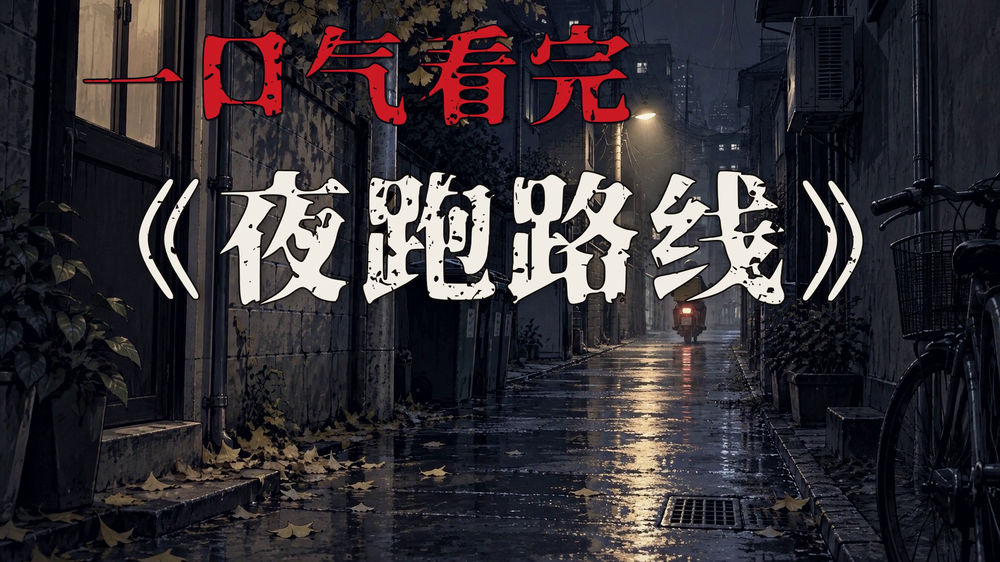

# 悬疑片头 V5（2026-11-10）

> 在 V4 基础上按用户要求加了两处：标题带书名号、左上红字「一口气看完」。已写回 `rules/悬疑/intro.md`（v1 定版）。



## 与 V4 的差异

| 项 | V4 | V5 |
|---|---|---|
| 标题 | 夜跑路线 · 450 px | **《夜跑路线》· 300 px**（6 字整串约 1620 px，占宽 84%） |
| 红字 | 无 | **一口气看完 · 225 px**（标题 3/4），红 `#CC1A24` |
| 红字位置 | — | 左上 (150,42)，左边缘对齐标题；标题后 0.25 s 淡入 200 ms |
| 副标 | 已去掉 | 去掉 |
| BGM / 标题音效 | 无 | 无 |
| 恐怖人声 | 5 条 | 不变（电平、位置同 V4） |
| 标题冲击 | 闪白/抖动/推镜/色散 | 不变 |

标题从 450 降到 300 是为了给《》让位：香萃一个字约 405 px（450 时），6 个字 450 会到 2430 px，必然出画；300 时 6 字 1620 px，和 V4 四字的占宽一样。

## 时间轴

| 段 | 起 | 时长 |
|---|---|---|
| 钩 1 | 0.35 s | 3.18 s |
| 钩 2 | 4.00 s | 3.38 s |
| 钩 3 | 7.79 s | 2.70 s |
| 标题 + 红字 | 10.79 s | 3.00 s（红字 11.04 起） |

总长 13.917 s / 334 帧 / 24 fps。

## 文件

- `sample_V5_intro.mp4`
- `frame_hook1|2|3.png`、`frame_impact.png`、`frame_impact2.png`、`frame_title.png`、`frame_title_late.png`
- `build/intro_v5.ass`
- `timeline.json`

## 已知问题

1. 标题窗 10.79–13.92 s 仍无口播；全线路规则要求标题层必须有口播，定版前必须补一句旁白标题句或立明确例外（见 `rules/悬疑/intro.md` §六）。
2. 红字 225 px 在 1920 宽下约 1010 px，比截图红框宽；若要收窄可降到 180–190（约标题 0.6）。
3. 香萃的《》是全宽字形，标题里显得很重；如果嫌抢，可把书名号单独降到 200 px。

## 复现

```powershell
& 'E:\program\language\python\Python-3.11.0\python.exe' work/intro-sample-s1/build_v5.py
```
